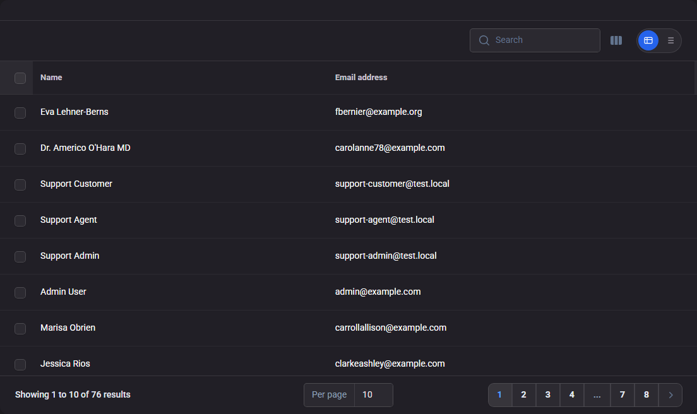
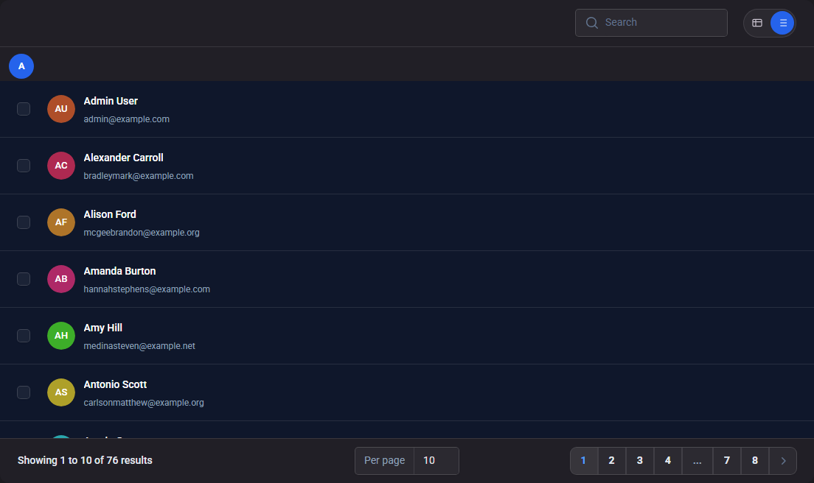
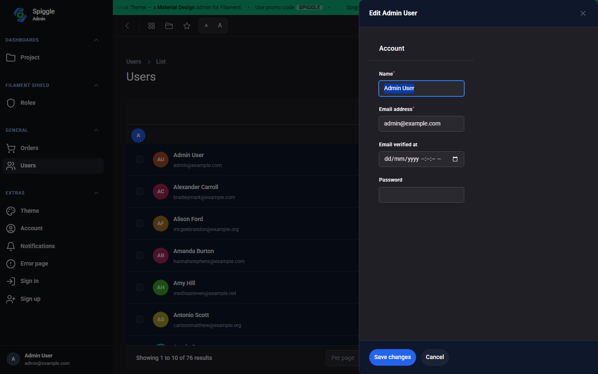

# Spiggle ListView

A Filament v5 plugin that adds a table / list toggle to every table on the panel.

Table view stays the default (the current Filament table). List view switches to stacked rows, groups records A–Z, and keeps search, pagination, and row click (slide-over or full page).

## Screenshots

**Table view (default)** — the normal Filament table, with the toggle in the toolbar:



**List view** — alphabetical groups, initials, title + subtitle. Click a row to view or edit:



**Row click** — same action as a table row (Users open a slide-over):



## Requirements

- PHP 8.3+
- Laravel 12 or 13
- Filament 5.7+

## Install

The package is not on Packagist yet. Add the GitHub repository, then require it:

```bash
composer config repositories.spiggle-list-view vcs https://github.com/skillbobby/Spiggle-List-View.git
composer require spiggle/list-view:^1.0
```

Register the plugin on your Filament panel:

```php
use Spiggle\ListView\Filament\ListViewPlugin;

public function panel(Panel $panel): Panel
{
    return $panel
        ->plugin(ListViewPlugin::make());
}
```

It works alongside other panel plugins (for example a theme):

```php
$panel
    ->plugin(MaterialThemePlugin::make())
    ->plugin(ListViewPlugin::make());
```

## How it works

1. A table / list control is injected at the end of every Filament table toolbar.
2. **Table** is the default. The existing columns, filters, search, and pagination stay as they are.
3. **List** rebuilds the current table as stacked rows:
   - Title from `name`, `title`, `number`, or the first text column
   - Subtitle from `email` or the next text column
   - Colored initials when the record has no avatar
   - Groups by first letter (A–Z)
4. The choice is stored in the session per Livewire table class, so each resource remembers its own mode.
5. Clicking a list row uses the same `recordAction` / `recordUrl` as the table (slide-over, modal, or full page).

No changes are required on individual resources. Any `HasTable` page gets the toggle.

## License

MIT
